# Prince Upadhyay
## Research & Technical CV

**Independent researcher · India**  
[ORCID 0009-0002-1170-4487](https://orcid.org/0009-0002-1170-4487) · [GitHub](https://github.com/reggaesharkk) · [Email](mailto:starxshark@gmail.com)

### Profile

I work across mathematical dynamics, spectral methods, formal reasoning, AI evaluation, and evidence verification. I build computational and formal artifacts with explicit assumptions, reproduce results where possible, and record counterexamples and open proof obligations alongside positive results.

My practice is deliberately evidence-bounded: I distinguish proofs from finite certificates, simulations from observations, and prototypes from independently validated systems.

### Research and technical work

- **Spectral methods — LRSC Odd-Ring Spectral Rank.** I maintain a public repository for a scoped odd-ring spectral-rank result and its finite eleven-channel certificate.
- **Computational number theory — Riemann bandwidth-one verification.** I collect finite certificates and computational checks while keeping the bridge to unconditional claims about zeta-zero distributions explicitly open.
- **Mathematical modeling — Theory of Bounded Existence.** I develop a model-specific program connecting bounded dynamics, computational models, and formal reasoning, with claims tied to stated assumptions.
- **Validated computation — Navier–Stokes Bridge Audit.** I work on finite Fourier–Galerkin computations and record the unresolved passage from finite models to continuum regularity.
- **Experimental design — Self-Referential Processing Design Lab and Ψ Self-Modeling Benchmark.** I document protocols, simulation checks, and diagnostic experiments with explicit limits on inference.
- **Verification tooling — IntentSeal and The Reggae Shark Protocol.** I build prototypes around claim scope, evidence provenance, policy-gated requests, and signed execution records.
- **Governed AI — SharkLang v2.4.2.** I released a policy-language/runtime review package with source, tests, CI, checksum manifests, evaluation terms, and a [Zenodo record](https://doi.org/10.5281/zenodo.23841845).
- **Release review — SharkLang Evidence Desk v0.1.1.** I built a local-first ZIP auditor for archive structure, SHA-256 manifests, and selected credential patterns. It does not extract or run archive contents; test and proof replay remain open. [Project](https://github.com/reggaesharkk/sharklang-evidence-desk) · [Site](https://reggaesharkk.github.io/sharklang-evidence-desk/).
- **STRENGTH research line.** I maintain public prototype and Lean-oriented repositories; conclusions remain limited to each repository's documented methods and evidence.

### Methods and tools

Python · Lean 4 · finite and numerical computation · test and regression design · reproducible build and checksum workflows · adversarial review · policy-gated API request flows · technical documentation.

### Selected public work

- [Reggae Shark Universe — public project map](https://github.com/reggaesharkk/Reggae-shark-universe-)
- [SharkLang v2.4.2 release](https://github.com/reggaesharkk/sharklang-v2.4.2-release) · [Zenodo DOI 10.5281/zenodo.23841845](https://doi.org/10.5281/zenodo.23841845)
- [LRSC odd-ring spectral rank](https://github.com/reggaesharkk/lrsc-odd-ring-spectral-rank)
- [Riemann bandwidth-one verification](https://github.com/reggaesharkk/riemann-bandwidth1-verification)
- [Theory of Bounded Existence](https://github.com/reggaesharkk/theory-of-bounded-existence)
- [Navier–Stokes Bridge Audit](https://github.com/reggaesharkk/navier-stokes-bridge-audit)
- [The Reggae Shark Protocol](https://github.com/reggaesharkk/The-Reggae-Shark-Protocol)
- [IntentSeal](https://github.com/reggaesharkk/intentseal)

### Collaboration

I value collaboration that begins with a real question, a careful challenge, or another set of eyes. If one of these projects intersects with your work, I welcome a thoughtful note. The repositories show what is established, what is only a prototype, and what remains open.

**Contact:** [starxshark@gmail.com](mailto:starxshark@gmail.com)

---

*This CV summarizes selected public research and software artifacts. Each repository states its own evidence boundaries, status, and license terms. Last updated 1 November 2026.*
