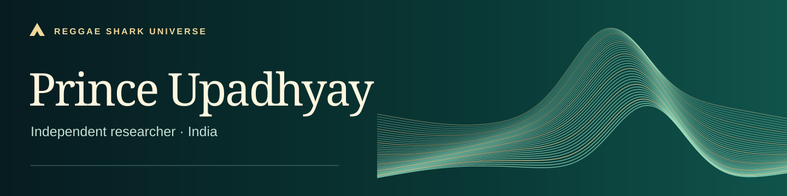

I build research software and study what it can establish about a mathematical model, a numerical computation, or an AI experiment. My public work spans 15 specialist repositories. Each milestone below links to the proof, benchmark, release, or audit that defines its scope.

## Navigate

[Computing](#computing) · [Mathematics](#mathematics) · [AI evaluation](#ai-evaluation) · [Verification tools](#verification-tools) · [Archives and contact](#archives-and-contact)

**[Full portfolio and pinned sources](https://github.com/reggaesharkk/Reggae-shark-universe-#the-public-work)** · [CV](https://github.com/reggaesharkk/reggaesharkk/blob/main/CV.md) · [ORCID](https://orcid.org/0009-0002-1170-4487)

## Computing

**SharkByte** is my experimental programming language, CPU simulator and verification workspace. Its largest public benchmark checked **4,294,967,296 populated entries** for a connected 50-qubit GHZ-family circuit. Colab and Google Compute Engine each compared the packed entries with a closed-form reference. Their basis and amplitude array hashes matched. [Google Cloud receipt](https://github.com/reggaesharkk/SharkByte/blob/26dae2551b926feae8641bc4bf46c498d03dcc12/evidence/connected-ghz50-gcp/2p32/sharkbyte-ghz50-4b-gcp-receipt.json) · [Colab receipt](https://github.com/reggaesharkk/SharkByte/blob/26dae2551b926feae8641bc4bf46c498d03dcc12/evidence/connected-ghz50-colab/retry-2p32/sharkbyte-connected-ghz50-4294967296-colab.json)

| Milestone | What the record supports |
| --- | --- |
| Sparse simulation | A connected 40-qubit circuit reached **33,554,432 populated amplitudes**. A separate eight-component circuit reached **16,777,216**, all compared with Cirq. A connected 20-qubit circuit agreed across four engines on all **1,048,576 amplitudes**. [Benchmark records](https://github.com/reggaesharkk/Reggae-shark-universe-#sharkbyte) · [Connected 40-qubit receipt](https://github.com/reggaesharkk/SharkByte/blob/main/evidence/connected-ghz40-32m-colab/sharkbyte-connected-ghz40-33554432-colab.json) |
| Local and cloud replay | The 16-million-entry Studio benchmark recorded **2.77 GiB** peak process memory on Windows ARM64. A separate moving-coordinate audit matched seven recorded payload fields across Windows, WSL2, Colab and Google Compute Engine. [Cross-platform records](https://github.com/reggaesharkk/SharkByte/tree/main/evidence/gce-moving-branch-cross-platform-20261120/) |
| Circuit simplification and support tracking | The simplifier cancelled **107 inverse pairs** in a 214-gate round trip. Exact replay checked protected coordinates across **322,560 four-qubit affine maps**. The cumulative error bound covers the specified X/Z/CX schedules. [Simplification receipt](https://github.com/reggaesharkk/SharkByte/blob/main/evidence/roundtrip17-inverses.json) · [Support bounds](https://github.com/reggaesharkk/SharkByte/blob/main/docs/certified-bounded-support.md) |
| Hadamard error accounting | H3 checks an error allowance at each gate. H4 reproduced the recorded output bits and numerical charges on Windows ARM64 and Ubuntu under WSL2. Public Gate 4b replays the archived fixture. The Gate 4c strict containment criterion failed. [H4 replay contract](https://github.com/reggaesharkk/SharkByte/blob/main/docs/h4-gate4b-compatibility.md) · [Gate 4c audit](https://github.com/reggaesharkk/SharkByte/pull/39) |
| Certify RC1 · private trials | The public report records **74 Lean modules** rebuilt on ARM64 and x86-64, **220/220** expected Linux x86-64 verifier outcomes, **10/10** SDK regressions and **9/9** native integration cases. It includes exact rational acceptance of **13/250**. The private quantum contract covers X/Z/CX/H up to eight qubits and 64 gates without pruning. Native ARM64 deployment remains blocked. [Public trial summary](https://github.com/reggaesharkk/SharkByte#private-research-milestones--gates-6b156b23) |

[Open the integrated Colab notebook](https://colab.research.google.com/github/reggaesharkk/SharkByte/blob/main/notebooks/SharkByte-Colab-Integrated-Verification.ipynb) · [All SharkByte milestones and notebooks](https://github.com/reggaesharkk/SharkByte#verified-achievements--google-cloud-colab-and-local-systems) · [↑ Back to navigation](#navigate)

## Mathematics

| Project | Mathematical milestone |
| --- | --- |
| [LRSC odd-ring spectral rank](https://github.com/reggaesharkk/lrsc-odd-ring-spectral-rank) | Proved that the channel-family rank equals the number of active reflection orbits under the stated masking conditions. A separate **99-site** certificate excludes every subset of ten or fewer channels and exhibits **11** that meet relative complex L₂ error 0.001 for the fixed instance. [Finite certificate](https://github.com/reggaesharkk/lrsc-odd-ring-spectral-rank/blob/main/finite-benchmark/k001-certificate/CERTIFICATE.md) |
| [Dynamical sector · Appendix A](https://github.com/reggaesharkk/physics-v1-dynamical-sector) | Lean verifies the vector-field inequalities on **all six faces** of the 3D box used in the forward-invariance proof. Numerical return maps and Floquet calculations examine attraction for the reported parameters. The observer-to-horizon bridge remains open. |
| [Theory of Bounded Existence · Appendix B](https://github.com/reggaesharkk/theory-of-bounded-existence) | Extended the analysis to a **4D soft-wall ODE**. The release records **17 Lean boundary theorems**, an exact rational Hopf monotonicity result, and coexistence of a stable origin and a periodic orbit at zero drive in the specified model. |
| [Navier–Stokes bridge audit](https://github.com/reggaesharkk/navier-stokes-bridge-audit) | Published finite Fourier–Galerkin records for the same initial data across cutoffs **N = 11 through 18**. The M14 recurrence depends on imported bounds. M15 and the passage to continuum regularity remain open. [Evidence timeline](https://github.com/reggaesharkk/navier-stokes-bridge-audit/blob/main/notes/NAVIER_STOKES_EVIDENCE_TIMELINE_2026_11_04.md) |
| [Riemann bandwidth-one verification](https://github.com/reggaesharkk/riemann-bandwidth1-verification) | Proved a finite-dimensional discrete Loewner band-truncation theorem and certified finite-filter sign counterexamples. The **68.820273%** calculation is conditional. **79.627%** is a finite-model result. [Mathematical status](https://github.com/reggaesharkk/riemann-bandwidth1-verification#current-mathematical-status) |
| [Riemann frontier audit](https://github.com/reggaesharkk/riemann-bandwidth1-frontier-audit) | Preserved exact-arithmetic replays and selected Lean proofs for individual steps. The **A1294** root predicate, the **WP84** ordinary-prime aggregate, the strict **>79%** simple-zero bound and the Riemann Hypothesis remain open. |

[↑ Back to navigation](#navigate)

## AI evaluation

| Project | Experiment or audit |
| --- | --- |
| [Self-Referential Processing Design Lab](https://github.com/reggaesharkk/self-referential-processing-designlab) | Completed **4,000 simulated model fits** across 500 replicates. Under the prespecified calibration rule, Phase 7 retained the correlated M1 model for a future study. Live confirmatory collection remains paused. |
| [Ψ Self-Modeling Benchmark](https://github.com/reggaesharkk/psi-self-modeling-benchmark) | Built a deterministic, two-choice self-versus-peer diagnostic with anonymized presentation, matched controls, style controls and a **50% chance baseline**. The v4 record is pre-confirmatory. |
| [STRENGTH-B3 Interceptor Core](https://github.com/reggaesharkk/STRENGTH-B3-Interceptor-Core) | Published a correction record withdrawing the earlier H4 performance, hardware-validation and firewall claims. It identifies the training, holdout and deployment evidence a future evaluation would require. |
| [Strength Intent · Lean](https://github.com/reggaesharkk/strength-intent-ns-lean) | Implemented a small recurrent forward step in Python/NumPy and C++. A separate Lean file proves two elementary inequalities under stated assumptions. H4 predictive value remains open. |

The October dossier also records a gradient audit of **100 recurrent networks**. Finite-difference checks agreed to within 10⁻⁹, while the proposed D−2 marker failed its test (*r* = −0.023). [Program 09 in the archived executive map](https://github.com/reggaesharkk/Reggae-shark-universe-#executive-map-of-the-ten-research-programs--26-october-2026-snapshot)

[↑ Back to navigation](#navigate)

## Verification tools

| Release | What I built and checked |
| --- | --- |
| [IntentSeal and the Verifiable Research Kernel](https://github.com/reggaesharkk/intentseal) | Froze the mediated-action kernel lineage and released VRK **v0.3.1** for claims with traceable evidence. Its release gates passed **30/30 tests**, rejected **33/33 adversarial cases** and checked certificate-bound promotion and dual seals. |
| [The Reggae Shark Protocol v1.3.2](https://github.com/reggaesharkk/The-Reggae-Shark-Protocol) | Built an application-level gateway with an Ed25519-signed execution ledger. The release records **42 Lean theorems** across three modules, including **16 lifecycle theorems**, plus **42/42 tests**. [Versioned archive](https://doi.org/10.5281/zenodo.23618032) |
| [SharkLang v2.4.2](https://github.com/reggaesharkk/sharklang-v2.4.2-release) | Released an approval-gated policy language with a compiler, runtime, signed example and Lean certificate. Ubuntu aarch64 passed **70/70 tests**. Windows ARM64 passed **69**, with one POSIX-only skip. [Archived release](https://doi.org/10.5281/zenodo.23841845) |
| [SharkLang Evidence Desk 0.1.1](https://github.com/reggaesharkk/sharklang-evidence-desk) | Built a local ZIP auditor that checks archive readability, path hazards, SHA-256 manifests and selected credential patterns without extracting or executing the contents. Test execution and proof checking remain separate review steps. |

[↑ Back to navigation](#navigate)

## Archives and contact

[Reggae Shark Universe](https://github.com/reggaesharkk/Reggae-shark-universe-) holds the project map, pinned source revisions and the research dossier for Programs 01–09. The [ten-program executive map](https://github.com/reggaesharkk/Reggae-shark-universe-#executive-map-of-the-ten-research-programs--26-october-2026-snapshot) links the dated milestones to their archival records.

I welcome independent replays, counterexamples and proposals for a stronger test. If you found a discrepancy, send the source revision, the smallest example that shows it and the result you expected. [Email me](mailto:starxshark@gmail.com) · [ORCID](https://orcid.org/0009-0002-1170-4487) · [↑ Back to navigation](#navigate)
