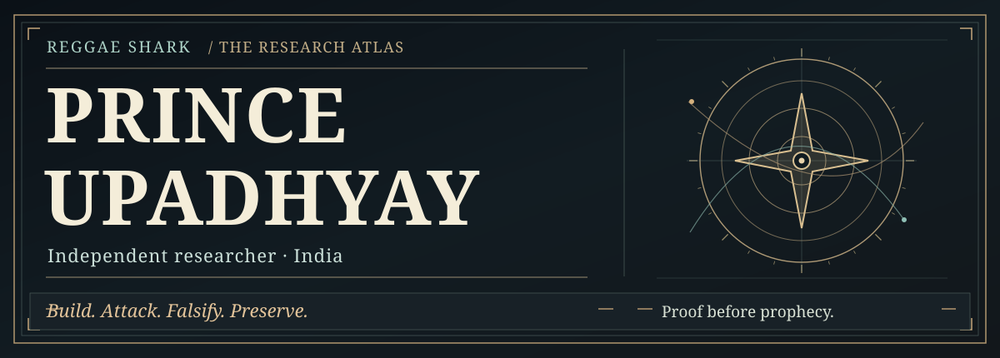
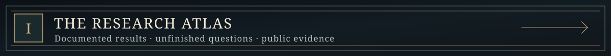
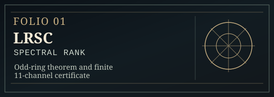
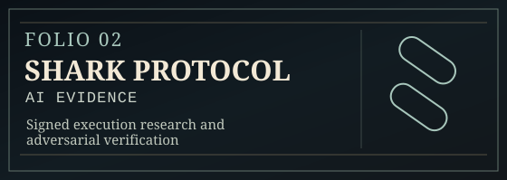
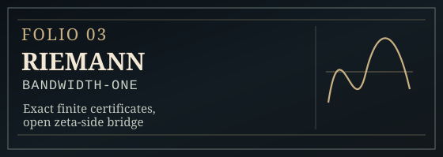
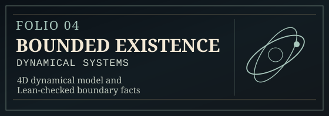
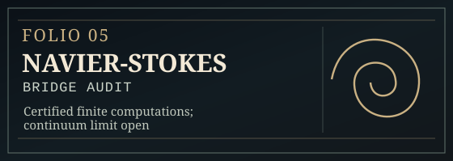
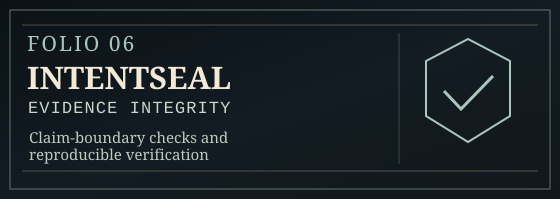
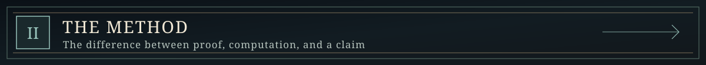
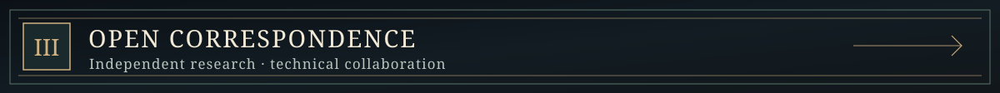

  

  <a href="https://github.com/reggaesharkk/Reggae-shark-universe-">THE ARCHIVE</a>
  &nbsp; · &nbsp;
  <a href="https://github.com/reggaesharkk?tab=repositories">ALL REPOSITORIES</a>
  &nbsp; · &nbsp;
  <a href="https://orcid.org/0009-0002-1170-4487">ORCID</a>
  &nbsp; · &nbsp;
  <a href="mailto:starxshark@gmail.com">WORK WITH ME</a>

### An independent observatory of mathematics and computation

I'm **Prince Upadhyay**, an independent researcher based in India. My work crosses **spectral theory, mathematical dynamics, machine-checked reasoning, AI evaluation and evidence verification**.

I build small exact results, ambitious models, experimental systems and adversarial tests. I also preserve counterexamples, broken assumptions and unanswered questions. The distinction matters: **a certificate for a finite model is not proof of a universal conjecture; a valid signature is not proof that an execution claim is true.**

> *The universe does not owe us certainty. Our claims owe the universe evidence.*

  

### Six featured programmes

Each plate opens its public source repository. The labels describe the **scope of the evidence**, not claims of universal discovery.

| | |
|:---:|:---:|
|  |  |
|  |  |
|  |  |

<b>Open the rest of the archive · Physics, experiments, AI memory &amp; documentation</b>

The featured selection is not the whole programme:

- [**Information-Theoretic Physics**](https://github.com/reggaesharkk/physics-v1-dynamical-sector) — dynamical sectors, model-specific Hopf analysis and boundedness certificates.
- [**Self-Referential Processing / Design Lab**](https://github.com/reggaesharkk/self-referential-processing-designlab) — controlled experimental design, simulation checks and prospective protocols.
- [**Ψ Self-Modeling Benchmark**](https://github.com/reggaesharkk/psi-self-modeling-benchmark) — diagnostic self/peer experiments with explicitly limited conclusions.
- **STRENGTH** — ongoing private experiments on information retention, causal markers and delayed tasks; no confirmed general memory advantage claimed.
- [**Reggae Shark Universe**](https://github.com/reggaesharkk/Reggae-shark-universe-) — programme-by-programme dossier, dated archives, source references, DOIs and evidence boundaries.

  

### What the evidence labels mean

| Label | Meaning in this archive |
|---|---|
| **PROVED** | A mathematical statement, within its stated assumptions and formal domain. |
| **CERTIFIED** | A finite result supported by a reproducible certificate or verified computation. |
| **SIMULATED** | Evidence about the simulated or experimental setup, not an external physical or security guarantee. |
| **FALSIFIED** | An attempted claim or route contradicted by a counterexample, retained in the record. |
| **OPEN** | An unresolved theorem, comparison, empirical question or deployment requirement. |

<b>Researcher's notebook · Selected established boundaries</b>

- **LRSC:** the documented odd-ring benchmark specifies \(M=99\) and an exact eleven-channel finite threshold certificate. It is **not** a universal compression optimum or a new cryptographic guarantee.
- **Riemann:** finite certificates and model-consumer percentages are not unconditional bounds for the distribution of zeta zeros; the strict \(>79\%\) route remains open.
- **Shark Protocol:** software tests and Lean theorems are verified only in their respective scopes. Production security still requires independently operated attestations, protected keys and fresh external checkpoints.
- **Navier–Stokes:** finite validated computations do not close the finite-to-continuum regularity problem.
- **STRENGTH:** a failed or inconclusive retention experiment is evidence worth archiving, not a result to quietly promote.

### What I am building toward

| The mathematical desk | The verification bench | The experimental lab |
|---|---|---|
| Exact finite certificates, operator estimates, and small theorems that can be checked. | Tamper-evident computational provenance, adversarial AI-evidence tests, and honest PASS / FAIL / OPEN verdicts. | Controlled studies of model memory, dynamics, and self-referential processing, with negative controls. |

  

### Open for paid technical assignments & research collaborations

I am available for **remote project-based work** in:

- **AI coding-agent evaluation** — testing generated programs, probing failure cases, analysing unsupported claims.
- **Mathematical and computational review** — scoped proof checks, finite certificates, numerical-reproducibility investigations.
- **Evidence and research audits** — source integrity, result replay, adversarial regression, and precise PASS / FAIL / OPEN reporting.
- **Benchmark development** — reproducible test cases, measurable acceptance criteria and technical documentation.

**Contact:** [starxshark@gmail.com](mailto:starxshark@gmail.com) · [Full research catalogue](https://github.com/reggaesharkk/Reggae-shark-universe-) · [ORCID record](https://orcid.org/0009-0002-1170-4487)

---

  <b>PRINCE UPADHYAY</b> · Independent Researcher · India
   
  <i>Proof before prophecy. Evidence before certainty.</i>

