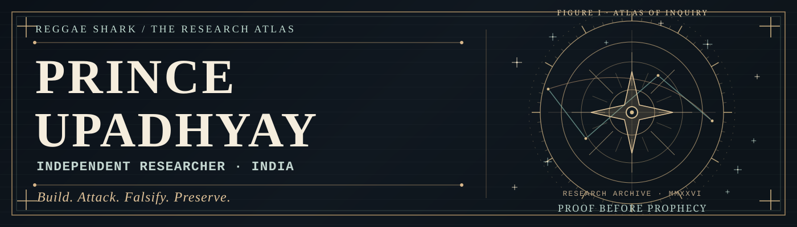

<p align="center">
  
</p>

<p align="center">
  <a href="https://github.com/reggaesharkk/Reggae-shark-universe-"><b>RESEARCH ARCHIVE</b></a>
  &nbsp; · &nbsp;
  <a href="https://github.com/reggaesharkk?tab=repositories"><b>REPOSITORIES</b></a>
  &nbsp; · &nbsp;
  <a href="https://orcid.org/0009-0002-1170-4487"><b>ORCID</b></a>
  &nbsp; · &nbsp;
  <a href="mailto:starxshark@gmail.com"><b>CONTACT</b></a>
</p>

---

### I. The Researcher

I'm **Prince Upadhyay**, an independent researcher based in India.

I work at the intersection of **mathematics, dynamical systems, formal methods, AI evaluation, and verifiable computational evidence**. I build exact certificates, explore models, construct counterexamples, and test whether ambitious claims survive contact with real computation.

**My method:** build it, attack it, falsify what fails, and preserve the record. A proof about a finite model is not a proof about the universe. A passing test is not a production-security certification.

**Fields:** spectral mathematics · dynamical systems · Lean 4 · reproducible computation · AI evidence & adversarial evaluation

---

### II. The Research Atlas

| Signal | Research programme | Verified or documented scope |
|:--|:--|:--|
| `01 // ∑` | **[LRSC · Odd-Ring Spectral Rank](https://github.com/reggaesharkk/lrsc-odd-ring-spectral-rank)** | Analytic rank theorem; exact finite **M = 99, K = 11** certificate. |
| `02 // ◈` | **[The Reggae Shark Protocol](https://github.com/reggaesharkk/The-Reggae-Shark-Protocol)** | Signed evidence, formal lifecycle model, verifiable AI-execution research; production trust remains under development. |
| `03 // ζ` | **[Riemann Bandwidth-One Verification](https://github.com/reggaesharkk/riemann-bandwidth1-verification)** | Discrete Loewner trace theorem, exact finite certificates and documented open zeta-side obligations. |
| `04 // Ψ` | **[Theory of Bounded Existence](https://github.com/reggaesharkk/theory-of-bounded-existence)** | Four-dimensional dynamical model, Lean-checked boundary results and model analysis. |
| `05 // ≋` | **[Navier–Stokes Bridge Audit](https://github.com/reggaesharkk/navier-stokes-bridge-audit)** | Validated finite Galerkin computations; continuum bridge explicitly open. |
| `06 // ⌁` | **[IntentSeal](https://github.com/reggaesharkk/intentseal)** | Claim-boundary checks, research provenance and reproducible verification prototypes. |

<details>
<summary><b>Explore other research programmes</b></summary>

<br>

- **[Information-Theoretic Physics](https://github.com/reggaesharkk/physics-v1-dynamical-sector)** — specified ODEs, symbolic Hopf calculation and bounded-dynamics models.
- **[STRENGTH](https://github.com/reggaesharkk/strength-interventional-retention-profile)** — ongoing experimental research into information retention and causal interventions; confirmatory claims remain open.
- **[Self-Referential Processing / Design Lab](https://github.com/reggaesharkk/self-referential-processing-designlab)** — controlled experimental design and simulation validation.
- **[Ψ Self-Modeling Benchmark](https://github.com/reggaesharkk/psi-self-modeling-benchmark)** — diagnostic and pre-confirmatory AI self-modeling experiments.
- **[Complete Research Universe](https://github.com/reggaesharkk/Reggae-shark-universe-)** — source-linked catalogue, releases, references, rights and evidence boundaries.

</details>

---

### III. Method & Evidence

```text
  ◉ OBSERVE  ──  FORMALIZE  ──  VERIFY  ──  ATTACK  ──  PRESERVE

  PROVED       / theorem in its stated mathematical domain
  CERTIFIED    / finite, auditable computational result
  SIMULATED    / evidence within a particular experimental model
  FALSIFIED    / counterexample preserved, not hidden
  OPEN         / unresolved proof or engineering requirement

  > NO SHORTCUTS FROM A MODEL TO THE WORLD.
  > NO SHORTCUTS FROM A HASH TO THE TRUTH.
```

### IV. Open for Collaboration

**Available for remote technical assignments and research collaboration** involving:

- AI coding-agent evaluation and rigorous failure analysis.
- Mathematical reasoning, scoped proof review and exact finite certificates.
- Reproducibility audits, test replay, evidence authentication and cross-platform verification.
- Benchmark design, adversarial regression tests and structured **PASS / FAIL / OPEN** reports.

**Inquiries:** [Contact about paid technical work](mailto:starxshark@gmail.com) · [Browse the full research archive](https://github.com/reggaesharkk/Reggae-shark-universe-)

<p align="center">
  <sub>Prince Upadhyay · Independent Research · India · <a href="https://orcid.org/0009-0002-1170-4487">ORCID 0009-0002-1170-4487</a></sub>
</p>
