<a href="https://github.com/reggaesharkk/Reggae-shark-universe-">RESEARCH MAP</a> &nbsp;·&nbsp; <a href="CV.md">RESEARCH CV</a> &nbsp;·&nbsp; <a href="https://orcid.org/0009-0002-1170-4487">ORCID</a> &nbsp;·&nbsp; <a href="https://github.com/reggaesharkk?tab=repositories">PUBLIC REPOSITORIES</a>

### I work where a question meets a test.

I'm **Prince Upadhyay**, an independent researcher in India. My work moves between mathematical dynamics, spectral methods, formal verification, AI evaluation, and evidence tooling.

I begin with an idea. I build a model, proof artifact, benchmark, or software system around it. Then I ask where it breaks. A finite certificate stays finite; an open conjecture stays open; a prototype carries its limits in plain sight.

> *An idea may travel far. A claim still has to answer to evidence.*

### Selected work

| Project | What I built | Boundary I keep visible |
|---|---|---|
| [**LRSC Odd-Ring Spectral Rank**](https://github.com/reggaesharkk/lrsc-odd-ring-spectral-rank) | A scoped spectral-rank result and finite certificate. | The result applies within its stated finite model. |
| [**Riemann Bandwidth-One Verification**](https://github.com/reggaesharkk/riemann-bandwidth1-verification) | Finite-band verification and conditional analysis. | This does not prove the Riemann Hypothesis. |
| [**Navier–Stokes Bridge Audit**](https://github.com/reggaesharkk/navier-stokes-bridge-audit) | Reproducible finite Fourier–Galerkin certificates. | Continuum transfer remains open. |
| [**Self-Referential Processing Design Lab**](https://github.com/reggaesharkk/self-referential-processing-designlab) | Experimental design and simulation validation. | Confirmatory collection is paused. |
| [**SharkLang v2.4.2**](https://github.com/reggaesharkk/sharklang-v2.4.2-release) | An approval-gated language/runtime for governed AI requests. | The release states its own evaluation boundary and terms. |
| [**Evidence Desk**](https://github.com/reggaesharkk/sharklang-evidence-desk) | A local-first ZIP structure and manifest auditor. | It checks archive evidence without executing contents. |

### How I work

**Build** a concrete object. **Probe** it with tests, counterexamples, and hostile questions. **Verify** the parts that can be verified. **Preserve** the failures and open obligations.

The broader map includes mathematical models, AI-behavior benchmarks, signed execution evidence, and formal methods. Each project has its own source repository and a stated scope. The [Reggae Shark Universe](https://github.com/reggaesharkk/Reggae-shark-universe-) is the index; the individual repositories hold the work.

### Collaboration

I value collaboration that begins with a real question, a careful challenge, or another set of eyes. If one of these projects intersects with your work, I welcome a thoughtful note. The repositories show what is established, what is only a prototype, and what remains open.

**Contact:** [starxshark@gmail.com](mailto:starxshark@gmail.com)

Independent research · India · Updated 1 November 2026

